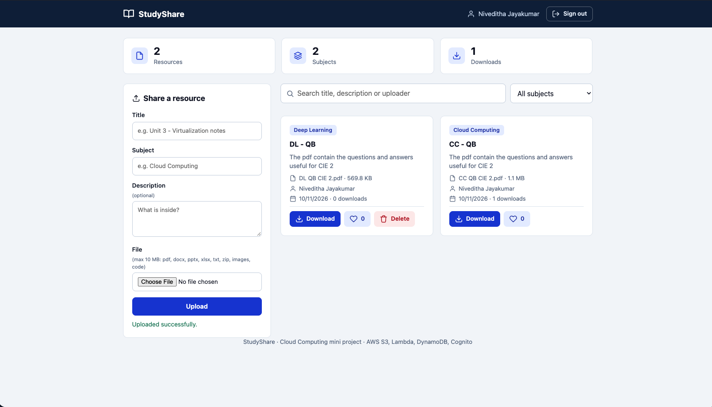

# StudyShare: Cloud-Based Student Resource Sharing Platform

A serverless web app where students sign up, then upload, browse, search, like and download
study material (notes, slides, question papers, code). It uses only AWS free-tier services and
is deployed entirely from the **AWS Management Console** (no CloudShell, no CLI, no servers).



## Contents
1. [Quick start](#quick-start)
2. [Features](#features)
3. [Architecture](#architecture)
4. [AWS services used](#aws-services-used)
5. [Project structure](#project-structure)
6. [API reference](#api-reference)
7. [Deployment guide](#deployment-guide) (Steps 0 to 8)
8. [Demo checklist](#demo-checklist)
9. [Troubleshooting](#troubleshooting)
10. [Updating the site later](#updating-the-site-later)
11. [Clean-up](#clean-up)
12. [Cloud concepts demonstrated](#cloud-concepts-demonstrated)
13. [Security design](#security-design)
14. [Future scope](#future-scope)

---

## Quick start

```bash
git clone <your-repo-url> && cd student-resource-sharing

# run the backend tests (offline, no AWS account needed)
python3 -m venv .venv && source .venv/bin/activate
pip install -r requirements-dev.txt
pytest -q

# configure the website, then follow the Deployment guide below
cp frontend/config.example.js frontend/config.js
```

`frontend/config.js` holds your own Function URL and Cognito Client ID and is git-ignored.

## Features

- Sign up with full name, username, email and password; verify the email with a 6-digit code
- Sign in with username and password; stay signed in; sign out
- Upload files up to 10 MB (pdf, doc, docx, ppt, pptx, xls, xlsx, txt, md, zip, png, jpg, jpeg, py, java, c, cpp)
- Browse resources as cards: subject, uploader, date, file size, downloads, likes
- Live search and subject filter
- Secure downloads through short-lived links
- Like and un-like (one like per user), download counter
- Only the uploader can delete their own resource
- Dashboard counters: total resources, subjects, downloads
- Responsive layout for laptop and phone

## Architecture

```
  Student's browser (laptop / phone)
      |
      |  loads the website (HTML, CSS, JS)
      v
  [CloudFront, optional: gives https://]  -->  [S3 website bucket, public]
      |
      |  1. Sign up / sign in / verify email ---------------> [Amazon Cognito user pool]
      |                                                         returns access token
      |  2. API calls with "Authorization: Bearer <token>"
      v
  [Lambda Function URL (HTTPS)] --> [AWS Lambda, Python 3.12]
                                         |   |   |
          checks the token  <------------+   |   +--> signs short-lived presigned URLs
          (Cognito GetUser)                  |
                                             v
                                   [DynamoDB: StudentResources]  (file details, likes, owner)

  3. The browser uploads / downloads the file DIRECTLY to / from [S3 files bucket, private]
     using the presigned URL, so files never pass through Lambda.

  IAM role (least privilege) for Lambda   |   CloudWatch Logs for monitoring
```

**Sign-in flow:** browser sends username and password to Cognito, receives tokens, keeps them in
`localStorage`, and refreshes them automatically before they expire.

**Upload flow:**
1. `POST /resources`: Lambda checks the token, saves details as `pending` and returns a presigned S3 POST form that enforces the 10 MB limit.
2. The browser uploads the file straight to the S3 files bucket.
3. `POST /resources/{id}/confirm`: Lambda checks the file exists in S3 and marks the resource `active`.

**Download flow:** `GET /resources/{id}/download` adds one to the download counter and returns a presigned
URL valid for 5 minutes. The browser downloads from S3.

## AWS services used

| Service | Role in the project | Free-tier note |
|---|---|---|
| **S3** (2 buckets) | Website hosting (public bucket) and file storage (private bucket) | 5 GB free tier; project uses a few MB |
| **Lambda** | Backend REST API in Python 3.12 | 1M requests per month, always free |
| **Lambda Function URL** | HTTPS endpoint for the API (replaces API Gateway) | Free |
| **DynamoDB** | NoSQL store for resource details | 25 GB and 25 RCU/WCU always free |
| **Cognito (user pool)** | Sign-up, email verification, sign-in, tokens | First 10,000 monthly users free |
| **IAM** | Least-privilege role for Lambda | Free |
| **CloudWatch Logs** | Lambda logs for debugging and monitoring | 5 GB free |
| **CloudFront** (optional) | HTTPS address for the website | Free plan or free tier at this scale |

Note on the AWS free tier: accounts created after 15 July 2025 get a Free plan with credits instead
of the older 12-month free tier. This project uses far less than a cent either way. Always do Step 0.

## Project structure

```
backend/lambda_function.py            Lambda code: all API routes + token check
frontend/index.html                   Pages: sign in, sign up, verify, main app (icons are inline SVG)
frontend/style.css                    Styling (navy / slate theme, responsive)
frontend/app.js                       Cognito calls, API calls, rendering, upload/download logic
frontend/config.example.js            Template for your settings (copy to config.js, which is git-ignored)
tests/test_backend.py                 Offline backend tests (AWS simulated with moto)
requirements-dev.txt                  Test dependencies
.gitignore, LICENSE                   Git housekeeping, MIT licence
aws-config/lambda-iam-policy.json     Inline IAM policy for the Lambda role
aws-config/files-bucket-cors.json     CORS rules for the private files bucket
aws-config/website-bucket-policy.json Public-read policy for the website bucket
```

## API reference

Every route needs the header `Authorization: Bearer <Cognito access token>`.
A missing or invalid token returns 401.

| Method | Path | Purpose | Notes |
|---|---|---|---|
| GET | `/resources?subject=&q=` | List active resources | Returns `isOwner` and `liked` per item for the caller |
| POST | `/resources` | Create details and get an upload form | Body: title, subject, description, fileName, contentType |
| POST | `/resources/{id}/confirm` | Mark active after the S3 upload | Uploader only |
| GET | `/resources/{id}/download` | Get a presigned download URL | Adds one download |
| POST | `/resources/{id}/like` | Toggle like for the caller | Returns `likes` and `liked` |
| DELETE | `/resources/{id}` | Delete resource and file | Uploader only, otherwise 403 |

---

## Deployment guide

Use **one region for everything**. This guide uses **Asia Pacific (Mumbai) `ap-south-1`**. Check the
region menu in the top-right of the console at the start of every step.
Replace `yourname` in bucket names with something unique to you (bucket names are global).
Keep a notepad open for: files bucket name, website bucket name, Function URL, Cognito Client ID.

### Step 0: Zero-spend budget alert
1. Search **Billing and Cost Management**, then **Budgets**, then **Create budget**.
2. Choose **Use a template (simplified)**, then **Zero spend budget**.
3. Enter your email and click **Create budget**.

### Step 1: DynamoDB table
1. Open **DynamoDB**, then **Tables**, then **Create table**.
2. Table name: `StudentResources`. Partition key: `resourceId`, type **String**.
3. Table settings: **Customize settings**. Capacity mode **Provisioned**.
4. Read capacity: Auto scaling **Off**, units `5`. Write capacity: Auto scaling **Off**, units `5`.
5. Click **Create table** and wait for status **Active**.

### Step 2: S3 files bucket (private)
1. Open **S3**, then **Create bucket**. Name: `srs-files-yourname-2026`.
2. Keep **Block all public access** ticked. Click **Create bucket**.
3. Open the bucket, **Permissions** tab, **Cross-origin resource sharing (CORS)**, **Edit**.
4. Paste the contents of [aws-config/files-bucket-cors.json](aws-config/files-bucket-cors.json) and click **Save changes**.

### Step 3: IAM role for Lambda
1. Open **IAM**, then **Roles**, then **Create role**.
2. Trusted entity **AWS service**, use case **Lambda**. Click **Next**.
3. Tick **AWSLambdaBasicExecutionRole** (lets Lambda write logs). Click **Next**.
4. Role name: `StudentResourcesLambdaRole`. Click **Create role**.
5. Open the role, **Add permissions**, **Create inline policy**, **JSON** tab.
6. Paste [aws-config/lambda-iam-policy.json](aws-config/lambda-iam-policy.json) and replace:
   - `REGION` with `ap-south-1`
   - `ACCOUNT_ID` with your 12-digit account number (click your name in the top-right)
   - `FILES_BUCKET_NAME` with your files bucket name
7. Click **Next**, name it `StudentResourcesAccess`, click **Create policy**.

### Step 4: Lambda function and Function URL
1. Open **Lambda**, then **Create function**, **Author from scratch**.
   - Name: `StudentResourcesApi`, Runtime: **Python 3.12**
   - Under **Additional settings**, turn on **Custom execution role**, choose **Use an existing role**, pick `StudentResourcesLambdaRole`.
2. Click **Create function**.
3. **Code** tab, open `lambda_function.py`, select all, delete, paste all of [backend/lambda_function.py](backend/lambda_function.py), click **Deploy**.
4. **Configuration** tab, **Environment variables**, **Edit**, add:
   - `TABLE_NAME` = `StudentResources`
   - `BUCKET_NAME` = your files bucket name
   Click **Save**.
5. **Configuration**, **General configuration**, **Edit**, set **Timeout** to `10` sec. Save.
6. **Configuration**, **Function URL**, **Create function URL** (or **Edit** if it exists):
   - Auth type **NONE** (the Lambda code does its own token check)
   - Tick **Configure cross-origin resource sharing (CORS)**
   - Allow origin: `*`
   - Allow headers: `content-type` and `authorization` (both are required)
   - Allow methods: `GET`, `POST`, `DELETE`
   - Max age: `86400`
   - Save, then copy the **Function URL** (no trailing slash needed in `config.js`).

### Step 5: Cognito user pool (login)
1. Open **Cognito**, then **User pools** (not "Identity pools"), then **Create user pool**.
2. Application type: **Single-page application (SPA)**. Name: `StudyShare`.
3. Sign-in identifier: **Username**.
4. Required attributes for sign-up: add **email** and **name**. (If your pool also lists given name as required, that is fine; the website sends it.)
5. If asked for a return URL, enter `http://localhost`.
6. Click **Create user pool**.
7. Check **Sign-up** settings: automatic verification messages must be **on**, verifying the **email address**.
8. Open **App clients**, open the client, and copy the **Client ID**.
9. Edit the client, **Authentication flows**: tick **ALLOW_USER_PASSWORD_AUTH** and keep **ALLOW_REFRESH_TOKEN_AUTH**. Save.

### Step 6: Configure the website and publish it on S3
1. Copy [frontend/config.example.js](frontend/config.example.js) to `frontend/config.js` (it is git-ignored, so your own values are never committed) and set:
   ```js
   window.API_URL = "https://xxxxxxxx.lambda-url.ap-south-1.on.aws";   // Function URL, no trailing slash
   window.COGNITO_REGION = "ap-south-1";
   window.COGNITO_CLIENT_ID = "your-app-client-id";
   ```
2. In **S3**, **Create bucket**, name `srs-website-yourname-2026` (or a nicer name such as `studyshare-yourname-2026`).
3. **Untick** Block all public access and tick the acknowledgement. Click **Create bucket**.
4. Open the bucket, **Upload**, add the 4 files from `frontend/` (`index.html`, `style.css`, `app.js`, `config.js`). Check the bucket name says **website** before uploading.
5. **Properties** tab, **Static website hosting**, **Edit**, **Enable**, index document `index.html`. Save.
6. **Permissions** tab, **Bucket policy**, **Edit**, paste [aws-config/website-bucket-policy.json](aws-config/website-bucket-policy.json) with `WEBSITE_BUCKET_NAME` replaced by your website bucket name. Save.
7. In **Properties**, copy the **Bucket website endpoint** and open it. Use `http://` explicitly.

### Step 7: Test the whole flow
1. Click **Create an account**, fill in name, username, email, password (8+ characters with upper and lower case, a number and a symbol).
2. Enter the 6-digit code from your email (check spam). You are signed in.
3. Upload a file, search for it, like it, download it, delete it.
4. Sign out and sign in again with the username and password.

### Step 8 (optional): HTTPS address with CloudFront
Why: S3 website addresses are HTTP only, and Chrome and Brave on phones often upgrade to HTTPS automatically,
which fails with `ERR_CONNECTION_RESET`. CloudFront fixes this.
1. Open **CloudFront**, **Create distribution** (choose the **Free** plan if offered).
2. Origin domain: paste the S3 website endpoint **without** `http://`, for example
   `srs-website-yourname-2026.s3-website.ap-south-1.amazonaws.com` (do not pick the bucket from the dropdown).
3. Origin protocol: **HTTP only**. Viewer protocol policy: **Redirect HTTP to HTTPS**.
4. Default root object: `index.html`. Do not enable the Web Application Firewall.
5. Create, wait for **Deployed** (5 to 15 minutes), then open `https://<distribution-domain>.cloudfront.net`.

---

## Demo checklist

Prepare two accounts and 3 to 4 sample files before the demo (Cognito's built-in email is limited to about 50 messages a day).

1. Show the sign-up page, then sign in with an existing account.
2. Upload a PDF and show it appear in the list.
3. In **S3**, show the object in the files bucket under `uploads/`.
4. In **DynamoDB**, **Explore items**, show the item (owner, likes, downloads).
5. Search and filter by subject.
6. Download the file, then refresh the DynamoDB item to show the download counter increased.
7. Open the file's direct S3 URL: **Access Denied** proves the bucket is private.
8. Sign in as the second account: no Delete button on the first account's file; like and un-like works.
9. In **Cognito**, show the users in the user pool.
10. In **CloudWatch**, **Log groups**, `/aws/lambda/StudentResourcesApi`, show the logs.
11. Open the site on a phone.

## Troubleshooting

| Symptom | Fix |
|---|---|
| Notice "Setup incomplete" on the sign-in page | `config.js` still has a placeholder. Fix it, re-upload `config.js` to the **website** bucket, hard-refresh (Cmd/Ctrl+Shift+R). |
| `Failed to fetch` after signing in | Function URL CORS is missing `authorization` in Allow headers (Step 4.6), or the URL in `config.js` is wrong. |
| "USER_PASSWORD_AUTH flow not enabled" | Cognito App client, Edit, tick **ALLOW_USER_PASSWORD_AUTH** (Step 5.9). |
| "Attributes did not conform to the schema" | The pool requires an attribute the form does not send. Send the exact message and add that attribute in `app.js` (given name is already handled). |
| No verification email | Check spam, click **Resend code**, check Sign-up settings (Step 5.7). |
| Session expired / sent back to sign in | Normal after the refresh token expires (30 days by default). Sign in again. |
| Function URL says `Forbidden` | Delete and re-create the Function URL with Auth type **NONE** so the console adds the public permission. |
| Upload says "check the files bucket CORS settings" | Paste the CORS JSON on the **files** bucket (Step 2.4). |
| "File has not been uploaded yet" | The S3 upload failed. Check the bucket name matches in the IAM policy and the `BUCKET_NAME` variable. |
| `Internal server error` | Lambda, **Monitor**, **View CloudWatch logs**. Usually a typo in a variable or the IAM policy. |
| Cannot save the website bucket policy ("public policies are blocked") | S3, **Block Public Access settings for this account**, untick, save, retry. |
| Website shows 403 Forbidden | Bucket policy missing or wrong bucket name, or Block Public Access still on for the website bucket. |
| "This site can't be reached" / `ERR_CONNECTION_RESET` on phone | The browser upgraded to HTTPS. Type `http://` explicitly, or use CloudFront (Step 8). |
| Site looks old after re-uploading | Hard-refresh or use a private window. With CloudFront, create an invalidation for `/*`. |
| Files uploaded to the wrong bucket | Delete them there and re-upload to the **website** bucket. |
| Old test items with no owner cannot be deleted | Delete them in DynamoDB, **Explore items**. |

## Updating the site later

- **Backend change:** paste the new `lambda_function.py` into Lambda and click **Deploy**.
- **Frontend change:** upload the changed files to the **website** bucket (they replace the old ones), then hard-refresh.
- **CloudFront:** after a frontend change, open the distribution, **Invalidations**, **Create invalidation**, `/*`.

## Clean-up

Do this after your evaluation is over:
1. S3: **Empty** and then **Delete** the website bucket and the files bucket.
2. CloudFront (if used): **Disable** the distribution, wait, then **Delete** it.
3. Cognito: delete the user pool `StudyShare`.
4. Lambda: delete `StudentResourcesApi`.
5. DynamoDB: delete `StudentResources`.
6. IAM: delete the role `StudentResourcesLambdaRole`.
7. CloudWatch: delete the log group `/aws/lambda/StudentResourcesApi`.
8. Billing: confirm the month shows $0.

## Cloud concepts demonstrated

- **Serverless computing (FaaS):** no servers to manage; Lambda scales automatically and bills per request.
- **Object storage:** S3 used for static website hosting and for user files.
- **NoSQL database:** DynamoDB key-value store with atomic counters and string sets for likes.
- **Identity and access management:** Cognito for user authentication, IAM for service permissions.
- **Presigned URLs:** time-limited direct access to private objects, without exposing the bucket.
- **CORS:** configured between the website, the Lambda Function URL and S3.
- **Monitoring:** CloudWatch Logs.
- **Content delivery (optional):** CloudFront for HTTPS and caching.
- **Cost management:** free-tier sizing and a zero-spend budget alert.

## Security design

- Authentication by Amazon Cognito; passwords never reach our code or database.
- Every API call needs a token; Lambda validates it with Cognito before doing anything.
- Ownership checks: only the uploader can confirm or delete a resource (enforced on the server, not just hidden in the UI).
- The files bucket is private; access is only through presigned URLs that expire after 5 minutes.
- S3 itself enforces the 10 MB limit through the presigned POST conditions.
- File-type allow-list on the server.
- Least-privilege IAM role: only the one table and the one bucket.
- All user text is HTML-escaped in the page to prevent cross-site scripting.

## Future scope

- Custom domain name with HTTPS (Route 53 and ACM).
- Social sign-in (Google) through Cognito; password reset screen.
- DynamoDB Global Secondary Index on `subject` instead of a scan as data grows.
- Amazon SNS email alerts when a new resource appears for a subject.
- Comments, ratings, and admin moderation through a Cognito group.
- Virus scanning of uploads and thumbnail generation through S3-triggered Lambda functions.
